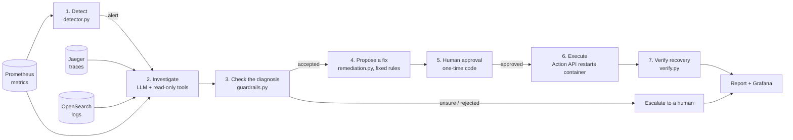

# Incident Zero Agent

An AI on-call assistant for a microservices shop. It watches the shop's metrics, notices when something breaks,
investigates with read-only telemetry tools, names the failing service with evidence, proposes a safe fix, waits for
a human to approve it, applies it, and checks that the shop really recovered.

Built by Team 6 for the *Incident Zero* hackathon (PES University, Oct–Nov 2026) on top of the
[OpenTelemetry Astronomy Shop demo](https://github.com/open-telemetry/opentelemetry-demo).

> **In plain words:** when a service in the online shop crashes at 3 a.m., an engineer is normally woken up and
> spends the first 20–30 minutes clicking through dashboards to find out *what* broke. This agent does that first
> part: within about 1.5 minutes it says "the `cart` service crashed, here is the evidence, I suggest restarting
> it". A human still says yes or no.

---

## How it works



| Step | What happens | Where |
|---|---|---|
| 1. Detect | Every 15 s, compares each service's error rate, p95 latency, per-operation failures, CPU, memory and traffic with **its own** last 30 min (10 min while warming up). Two failing checks in a row raise an alert. | `detector.py` |
| 2. Investigate | An LLM (Gemini via LangChain) asks for evidence using read-only tools: metrics, traces, logs, service health. Budget: 8 model calls, 16 tool calls, 240 s. | `orchestrator.py`, `reasoning.py`, `telemetry.py` |
| 3. Check | The diagnosis must name **one** service and cite real evidence IDs. Feature-flag wording never reaches the model, and a diagnosis that mentions flags is rejected. | `guardrails.py`, `safety.py` |
| 4. Propose | Plain code, not AI: a restart is proposed only for a *process* fault (crashed, crash-looping, hung, starved of CPU/memory). Code bugs are escalated, not restarted. | `remediation.py` |
| 5. Approve | A browser page shows the proposal. The human types a one-time code printed by the Action API. Unanswered requests expire. | `approval_ui.py`, `action_server.py` |
| 6. Execute | Only the Action API process can restart containers, only from an allowlist, and a kill switch blocks everything. | `action_executor.py`, `action_catalog.json` |
| 7. Verify | Waits 120 s, then checks the service's health twice, 30 s apart. The report ends as RECOVERED, NOT_RECOVERED or ESCALATED. | `verify.py`, `report.py` |

More detail: [INTEGRATION.md](INTEGRATION.md) (full chain), [docs/ACTION_API_ARCHITECTURE.md](docs/ACTION_API_ARCHITECTURE.md),
[ACTION_API.md](ACTION_API.md), [TELEMETRY_SUMMARY.md](TELEMETRY_SUMMARY.md).

## Results

Full numbers and method: [EVALUATION.md](EVALUATION.md). Raw logs: [evals/results/](evals/results/).

| Test | Result |
|---|---|
| 10 simulated incidents × 4 runs (incl. invented service names) | **40 / 40** correct, 0 confident-and-wrong |
| Live demo, latest run per case: 5 crashed services + 2 no-fault runs (23–25 Nov) | **7 / 7** pass: every crash found (median ~1 min), right service, right fix, 0 false alarms |
| Detector replays of recorded live data with the current rules | 24 Nov: 0 false alarms; 22 Nov: 18 / 18 faults detected, 1 false alarm |
| Automated tests (`pytest`) | 341 pass |

What the results do **not** show: each live case ran once or twice on one laptop, the feature-flag faults
(partial failures, slowdowns) have not been re-run live with the current rules, and the agent depends on one free LLM
provider (Gemini). Details in [EVALUATION.md](EVALUATION.md).

---

## Quick start

### What you need

- Docker Desktop with enough memory for the OpenTelemetry demo (see its own README)
- Python 3.11 or newer
- A free Gemini API key: <https://aistudio.google.com/apikey>

Commands are for Windows PowerShell. On macOS / Linux use `.venv/bin/python` instead of `.\.venv\Scripts\python.exe`.

### 1. Get the demo shop and apply our small demo changes

```powershell
git clone https://github.com/open-telemetry/opentelemetry-demo.git
cd opentelemetry-demo
git am (Get-ChildItem ..\incident-zero-agent\demo-patches\*.patch)   # see demo-patches/ below
docker compose -f compose.yaml -f compose.observability.yaml up -d
```

[`demo-patches/`](demo-patches/) holds the only changes we made to the demo: higher memory limits for checkout,
product-catalog and payment (they crashed from memory pressure), span metrics every 15 s instead of 60 s (faster
detection), a load-generator fix, and a named Prometheus volume so metric history survives a restart. If a patch no
longer applies to the latest demo, the changes are small enough to make by hand from the patch text.

### 2. Set up the agent

```powershell
cd ..\incident-zero-agent
py -3.11 -m venv .venv
.\.venv\Scripts\python.exe -m pip install -r requirements.txt
copy .env.example .env            # then paste your GOOGLE_API_KEY into .env
docker compose -f grafana/compose.yaml up -d   # optional: the agent's Grafana on http://localhost:3001
```

### 3. Check everything

```powershell
.\.venv\Scripts\python.exe cli.py doctor
```

Prints PASS / WARN / FAIL for Prometheus, Jaeger, OpenSearch, metric history, the LLM key and Grafana, with a fix for
each problem. The detector needs 10 minutes of history after a fresh start before it can alert; `doctor` says how long
to wait. (OpenSearch changes port on each demo restart; the agent finds the current one itself.)

### 4. Run it

**Diagnosis only** (safe, nothing is changed):
```powershell
.\.venv\Scripts\python.exe cli.py watch --diagnose-only
```

**Full chain** (detect, diagnose, approve, restart, verify), in two terminals:
```powershell
# terminal 1 (once):  .\.venv\Scripts\python.exe cli.py action-api init-token
.\.venv\Scripts\python.exe cli.py action-api serve --executor docker   # approval codes are printed here
# terminal 2
.\.venv\Scripts\python.exe cli.py watch --execute
```

Now break something, for example `docker stop cart`. About 1.5 minutes later terminal 2 prints an approval link
(`http://127.0.0.1:8787/ui/...`). Open it, type the code from terminal 1 and approve. The Action API restarts the
container and the agent checks the recovery.

- Without `--execute` the approved request is only validated (dry run).
- Without `--executor docker` the Action API only simulates the restart.
- `cli.py kill-switch on` blocks all actions.

**One manual investigation:**
`cli.py investigate --incident-id INC-1 --symptom "checkout errors"`.

Each investigation writes `runs/<id>/` containing:
- the report (`_report.json` and `.md`)
- every piece of evidence
- the full LLM transcript
- the proposed Action API request

---

## Evaluate it yourself

| What | Command | Needs |
|---|---|---|
| Unit and end-to-end tests (simulated telemetry, no LLM) | `python -m pytest -q tests` | nothing |
| Full agent on 10 simulated incidents | `python evals/run_scenarios.py` (add `--rename` for invented names) | LLM key |
| Tools-only ceiling (fixed policy, no LLM) | `python evals/run_scenarios.py --mode oracle` | nothing |
| Live suite: inject real faults, detect, investigate, score | `python evals/live_suite.py --run ID [--only S1 S2] [--flags file]`; resume with the same ID | running demo |
| Replay the detector on recorded Prometheus data | `python evals/replay_detector.py --date YYYY-MM-DD` | running demo with history |

The simulator (`evals/sim_world.py`) answers the agent's real Prometheus / Jaeger / OpenSearch HTTP queries, so
everything above the HTTP layer is the real agent. The live suite marks a case INVALID (not counted, re-run on resume)
if the laptop slept during it.

## Safety rules the code enforces

- **Read-only investigation.** The LLM can only call read-only telemetry tools. It cannot run commands.
- **No AI in the fix decision.** Which fix to propose comes from fixed, tested rules, and only allowlisted actions exist.
- **A human approves every action** with a one-time code. Requests expire and fail closed, and a kill switch blocks all actions.
- **No peeking at the answer.** The agent never reads feature-flag state. Flag text in telemetry is replaced by
  `[message text withheld by policy]`, and diagnoses that mention flags are rejected.
- **Bounded.** Each investigation has a budget of 8 model calls, 16 tool calls, 240 s and 150k tokens.
- **Honest about uncertainty.** If it can't support a diagnosis with evidence, it escalates instead of guessing. If the
  LLM provider is down, it retries with growing waits inside the time budget, then escalates.

## Tech stack

| Part | Choice | Why |
|---|---|---|
| Language | Python 3.11 | Fast to write, and has the best LLM and observability libraries |
| LLM | Google Gemini Flash-Lite (free tier), with a fallback model | Free, fast and good at tool calling. Groq is supported as an alternative |
| LLM connector | LangChain (`init_chat_model`, `bind_tools`, message types only) | Changing provider is a setting, not code. The agent loop itself is our own code, so budgets stay exact |
| Telemetry | Prometheus (metrics), Jaeger (traces), OpenSearch (logs) | What the OpenTelemetry demo already exports |
| Data contracts | Pydantic, JSON Schema | Every report, evidence item and Action API request is validated |
| Action API | Python standard-library HTTP server | Small and auditable. It is the only process allowed to touch Docker |
| Dashboards | Grafana (own container) | Shows every stage of an incident next to the demo's metrics |
| Tests | pytest | 341 tests, no network or LLM needed |

## Project layout

```
cli.py                 entry point: doctor, watch, investigate, action-api, kill-switch
detector.py            alert rules against each service's own history
orchestrator.py        the bounded investigation loop
reasoning.py           LLM prompt, tool calling, retries and fallback (LangChain)
telemetry.py           read-only tools over Prometheus, Jaeger, OpenSearch
guardrails.py          checks on the diagnosis (evidence cited, one service, no flag leak)
remediation.py         fix rules (restart only for process faults)
action_server.py       Action API: approval, allowlist, execution, kill switch
verify.py              recovery check after a fix
report.py              incident report (JSON + Markdown)
grafana*/              agent's Grafana container, dashboards, annotations
evals/                 simulator, scenarios, live suite, detector replay, results
tests/                 pytest suite
demo-patches/          the small changes we made to the OpenTelemetry demo
docs/                  Action API architecture, OpenAPI spec, end-to-end demo script
```

## Known limitations

1. **Quiet faults can be missed.** Slow leaks, slowdowns on rare paths and some partial failures may not trip the
   detector. This is the weakest part.
2. **The only automatic fix is a restart.** Code bugs, bad configuration and failing dependencies are correctly
   escalated, but a human still has to fix them.
3. **Small evidence base.** One laptop, one or two runs per fault, one free LLM provider. A Gemini outage longer than
   the 240 s budget still ends with a human.

## Team

Team 6, Incident Zero hackathon. Roles:
- Harsha: CLI, orchestration, integration, Action API
- Neha ([@pnehasai](https://github.com/pnehasai)): telemetry tools, detector, evaluation
- Harshita: LLM reasoning and prompt
- Deepika: guardrails and actions
- Aditya: models, report, verification

## License

Apache License 2.0 (see [LICENSE](LICENSE)), the same as the OpenTelemetry demo it builds on.
